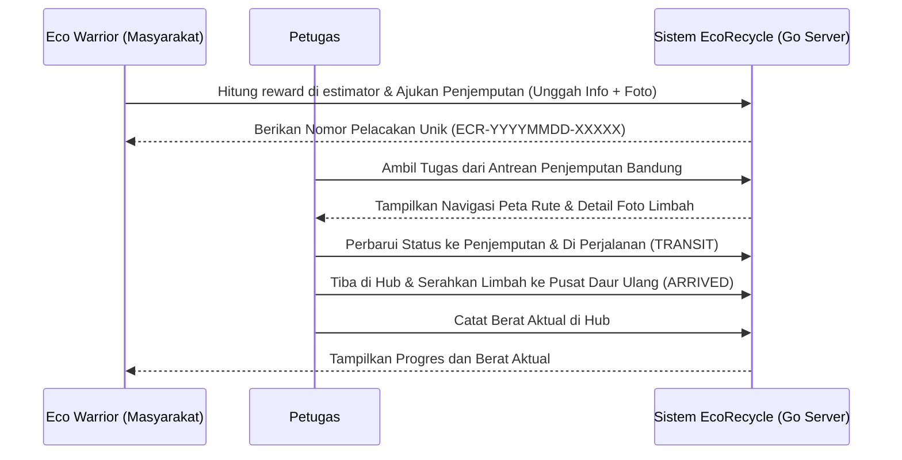

# SAMPIRA — Sampah, Informasi, Pelaporan, dan Respons Aksi

Phase 2 mengintegrasikan pickup, timbang aktual, dan pencatatan pembayaran eksternal yang diverifikasi. Lihat [progres Phase 2](docs/progress/PHASE_02_PICKUP_WORKFLOW.md), [audit kumulatif](docs/progress/SAMPIRA_PHASE_01_02_COMPREHENSIVE_REPORT.md), dan [changelog](docs/progress/SAMPIRA_PHASE_01_02_CHANGELOG.md).

SAMPIRA mengembangkan alur penjemputan sampah terpilah EcoRecycle. Phase 1 mengamankan autentikasi dan akses ke portal Masyarakat, Petugas, Admin, serta Administrator. Lihat [panduan operasi](docs/phase-01-operations.md) dan [laporan verifikasi final](docs/progress/PHASE_01_FINAL_VERIFICATION.md).


## Cakupan kategori (29 Oktober 2026)

Landing page, estimator, pengajuan, portal kolektor/admin, dan profil sudah mendukung organik, anorganik, elektronik, dan B3 rumah tangga. Kategori baterai dikelompokkan ke B3. Anorganik dirinci menjadi PET bening, kertas/kardus, besi, dan kaca agar tarif tidak disamaratakan.

Tarif anorganik memakai acuan awal Bank Sampah Indonesia; organik dan B3 rumah tangga umum adalah setoran tanpa reward awal. Biaya pemrosesan kategori baru belum diberlakukan. Tarif elektronik sebelumnya dipertahankan. Lihat [riset, asumsi tarif, dan batas kategori](docs/waste-categories.md).

**Database yang sudah ada:** jalankan `db_init/add_waste_categories.sql` pada database aplikasi. Migrasi ini hanya menambah kategori yang belum ada. Untuk migrasi empat role, ikuti [panduan operasi Phase 1](docs/phase-01-operations.md). Inisialisasi database baru mencakup seluruh kategori.

## 🌟 Deskripsi Proyek
Masyarakat mengajukan penjemputan dan memantau progresnya. Petugas mengambil permintaan dari antrean. Petugas yang ditugaskan juga mencatat berat aktual di hub. Admin memiliki portal laporan fasilitas. Administrator mengelola pengumuman portal.

---

## 🛠️ Fitur Utama

1. **Carbon & Eco-Reward Estimator**: Hitung potensi reward menurut kategori serta simulasi karbon dengan faktor tetap 2,5 kg CO2/kg; simulasi ini belum memakai faktor emisi terverifikasi per material.
2. **Sampah Tracking Timeline**: Lacak perjalanan sampah terpilah Anda dengan timeline interaktif (Pending âž” Dijemput âž” Transit âž” Tiba di Hub âž” Selesai & Dibayar).
3. **Photo Upload Verification**: Fitur unggah foto sampah saat mengajukan penjemputan untuk memudahkan kolektor melakukan verifikasi visual kondisi awal barang secara remote.
4. **Verifikasi berat dan reward final**. Petugas yang ditugaskan mencatat berat aktual untuk perhitungan reward. Setelah timbang, reward positif menunggu pembayaran eksternal. Administrator mencatat pembayaran yang telah diverifikasi dengan bukti.
5. **Gamified Eco-Level & Impact Score**: Klasifikasi tingkatan pengguna berdasarkan akumulasi berat sampah terpilah yang didonasikan (Bronze Saver, Silver Guardian, Emerald Hero) yang dihitung secara dinamis.
6. **Interactive Maps (Leaflet.js)**: Pemetaan visual rute perjalanan dan penentuan titik koordinat penjemputan donor oleh kolektor secara interaktif di wilayah Bandung.
7. **Portal berbasis role**. Masyarakat, Petugas, Admin dan Administrator memakai portal masing-masing.

---

## 📐 Arsitektur & Teknologi

### Tech Stack
- **Backend (Web Service)**: Go (Golang) 1.24+ (Standalone HTTP Server menggunakan routing native berkinerja tinggi)
- **Database**: MySQL / MariaDB (Koneksi database terkelola dengan database/sql pool)
- **Environment Variables**: Konfigurasi dinamis lokal dimuat secara native melalui parser `.env` mandiri.
- **Frontend**: HTML5, Vanilla CSS3 (Modern Tech HSL Design), JavaScript (Vanilla ES6)
- **Pustaka**: SweetAlert2 (Notifikasi UI), Leaflet.js (Peta Rute), Chart.js (Grafik Tren Bulanan)

### Persyaratan Sistem
- **Go Compiler**: Go 1.24 ke atas
- **Database**: MySQL 5.7+ atau MariaDB 10.4+ (XAMPP MySQL tetap dapat digunakan)

---

## Struktur Folder Proyek
```text
/tubes_pemrograman3
|-- app/
|   `-- Views/                         # Template antarmuka HTML
|       |-- index.html                 # Landing page edukatif
|       |-- auth.html                  # Halaman auth legacy/pendukung
|       |-- login.html                 # Autentikasi masuk
|       |-- register.html              # Pendaftaran akun
|       |-- dashboard.html             # Portal Eco Warrior
|       |-- collector.html             # Portal Petugas
|       |-- admin.html                 # Portal Admin laporan fasilitas
|       |-- administrator.html         # Portal Administrator dan CMS
|       `-- profile.html               # Manajemen profil pengguna
|-- assets/
|   |-- css/                           # Styling frontend
|   |   |-- style.css
|   |   |-- auth.css
|   |   |-- dashboard.css
|   |   |-- collector.css
|   |   `-- admin.css
|   |-- js/                            # Logic frontend
|   |   |-- home.js
|   |   |-- auth.js
|   |   |-- dashboard.js
|   |   |-- collector.js
|   |   `-- admin.js
|   `-- img/                           # Aset gambar dan media
|-- cmd/
|   `-- server/
|       `-- main.go                    # Entry point HTTP server Go
|-- internal/
|   |-- handlers/                      # REST API handler per domain
|   |   |-- auth_handler.go
|   |   |-- pickup_handler.go
|   |   |-- tracking_handler.go
|   |   `-- payout_handler.go
|   |-- middleware/                    # Request parser dan response helper
|   |   `-- auth_middleware.go
|   |-- models/                        # Model dan konstanta domain
|   |   |-- user.go
|   |   `-- pickup.go
|   |-- repositories/                  # Akses data MySQL
|   |   |-- user_repository.go
|   |   `-- pickup_repository.go
|   `-- services/                      # Logika pendukung layanan
|       |-- auth_service.go
|       `-- reward_service.go
|-- db_init/
|   `-- db_init.go                     # Database installer dan seeder
|-- uploads/                           # Penyimpanan foto sampah, Git-ignored
|-- .env                               # Kredensial lokal, Git-ignored
|-- .env.example                       # Template environment variable
|-- .gitignore
|-- go.mod
|-- go.sum
`-- README.md
```

---

## 🔒 Skema Keamanan & Database

Basis data `ecorecycle` menggunakan relasi data yang optimal dengan skema berikut:

### Keamanan Web Service
1. **SQL Injection Prevention**: Seluruh operasi query database menggunakan parameter placeholder `?` (`db.Prepare()` atau `db.QueryRow()`, `db.Exec()`) bawaan driver Go MySQL.
2. **Autentikasi API**. Token HMAC-SHA256 berlaku hingga 24 jam. API menerima Bearer atau cookie HttpOnly same-origin. Server memeriksa sesi, status akun dan role terkini setiap kali. Logout mencabut sesi di server.
3. **Pemisahan Kredensial**: Semua data sensitif (password DB, JWT Secret Key) disimpan di file `.env` yang diabaikan oleh Git.
4. **Server-Side Input Validation**: 
   - Pemeriksaan dasar format email.
   - Validasi kekuatan kata sandi minimal 6 karakter saat registrasi.
   - Validasi tipe data numerik positif untuk berat limbah (mencegah nilai negatif).

### Skema Tabel Database
1. **Tabel `users`**: Menyimpan akun pengguna. Password diamankan dengan hash `bcrypt`.
2. **Tabel `waste_categories`**: Daftar kategori sampah terpilah dan rate reward per kilogram (KG).
3. **Tabel `pickups`**: Tabel transaksi donasi utama. Dilengkapi kolom `photo_url` untuk foto limbah dan kolom `collector_id` untuk pemetaan kurir penjemput.
4. **Tabel `pickup_history`**: Mencatat detail lini masa dan riwayat mutasi status donasi.
5. **Tabel `transactions`**: Menyimpan riwayat transaksi. Status historis memerlukan rekonsiliasi bukti eksternal.

---

## 🚀 Panduan Instalasi (Lokal Dev)

### 1. Setup Proyek
1. Clone repositori ini dan letakkan di direktori server lokal Anda.
   (Contoh: `C:/xampp/htdocs/progress_tubes/tubes_pemrograman3/`).
2. Pastikan MySQL/MariaDB server Anda sudah aktif di XAMPP Control Panel (Port `3306`).

### 2. Konfigurasi Environment (.env)
1. Salin berkas `.env.example` menjadi `.env`:
   ```bash
   cp .env.example .env
   ```
2. Sesuaikan kredensial database dan isi `JWT_SECRET` dengan nilai acak minimal 32 byte. Setel `SAMPIRA_LISTEN_HOST=127.0.0.1` untuk pengembangan lokal. Untuk HTTPS di belakang reverse proxy tepercaya, aktifkan `SAMPIRA_SECURE_COOKIE=true`.

### 3. Inisialisasi Database
Untuk skema baru, jalankan initializer berikut. Untuk skema yang sudah ada, ikuti [prosedur migrasi](docs/phase-01-operations.md#migrasi-database-yang-sudah-ada).
```powershell
go run ./db_init
```
*(Catatan: Folder dinamai `db_init` agar Windows UAC tidak memblokir jalannya file executable biner dengan label "setup" / "install" saat eksekusi)*

### 4. Menjalankan Server Go
Kompilasi server utama dan jalankan:
```powershell
go build -o ecorecycle.exe ./cmd/server
.\ecorecycle.exe
```
Buka browser pada alamat: **`http://localhost:8080`**

### 5. Akun aplikasi

Registrasi publik menghasilkan akun Masyarakat. Ikuti [prosedur bootstrap](docs/phase-01-operations.md#bootstrap-administrator) untuk membuat Administrator.

---

## 🌐 Dokumentasi API (Web Service)

Semua request API mengembalikan respons JSON seragam dengan HTTP response status codes yang tepat (misal: 201 Created, 401 Unauthorized, 405 Method Not Allowed).

### 1. Autentikasi Pengguna
* **Login**: `POST /api/auth/login`
  - Input: `{"email": "...", "password": "..."}`
  - Output: Mengembalikan Signed Token (HMAC SHA256) untuk hak akses di request berikutnya.
* **Register**: `POST /api/auth/register`
  - Input: `{"name": "...", "email": "...", "password": "..."}`
  - Fitur: Memvalidasi format email dan panjang sandi minimal 6 karakter.

### 2. Pengelolaan Sampah (Memerlukan Token Autentikasi)
* **Request Penjemputan**: `POST /api/ecorecycle/request_pickup` (Multipart Form-Data)
  - Header: `Authorization: Bearer <token>`
  - Input: `item_description` (text), `pickup_address` (text), `contact_phone` (text), `weight_kg` (numeric > 0), `category` (text), `photo` (file gambar - opsional)
* **Ambil Tugas (Petugas)**: `POST /api/ecorecycle/assign_collector`
  - Header: `Authorization: Bearer <token>`
  - Input: `{"tracking_number": "ECR-XXXX-XXXXX"}`
* **Pembaruan Status Misi**: `POST /api/ecorecycle/pickup_status`
  - Header: `Authorization: Bearer <token>`
  - Input: `{"tracking_number": "ECR-...", "status": "transit|arrived", "location": "...", "notes": "..."}`
* **Lacak Tracking Number**: `GET /api/ecorecycle/pickup_status?tracking_number=ECR-...`
* **Kalkulator Estimator**: `POST /api/ecorecycle/estimate_reward`
  - Input: `{"category": "...", "weight_kg": ...}`
  - Fitur: Mengambil data tarif terkini dari database MySQL secara real-time.
* **Pencatatan Pembayaran Eksternal (Administrator)**: `POST /api/ecorecycle/process_payout`
  - Header: `Authorization: Bearer <token>`
  - Input: `{"pickup_id": ...}`

---

## 🔄 Alur Kerja Sistem (Workflow)



---

## 🛠️ Pemecahan Masalah (Troubleshooting)

1. **UAC Elevation Required saat setup**: Windows secara default menolak eksekusi biner dengan nama yang mengandung kata "setup". Gunakan build rename: `go build -o db_installer.exe ./db_init` lalu jalankan `.\db_installer.exe`.
2. **Koneksi Database Terputus / Refused**: Pastikan MySQL di XAMPP Control Panel sudah aktif. Jika Anda menggunakan port non-standar (misalnya `3307`), buka file `.env` dan ubah `DB_HOST=localhost` menjadi `DB_HOST=localhost:3307`.
3. **API Mengembalikan Error 401**: Pastikan header `Authorization` dikirimkan dalam format `Bearer <token>` dan token belum kadaluwarsa (berlaku 24 jam setelah login).
4. **Sesi portal kedaluwarsa**. Login kembali untuk memperbarui cookie dan token.

---

## 📈 Persentase Progress Aplikasi saat ini
### Riwayat konversi backend EcoRecycle
Backend platform telah sepenuhnya dikonversi ke **Go (Golang)**:
- [x] **Inisialisasi Modul & Dependensi Go** (100% Selesai)
- [x] **Installer Database setup.go & db_installer.exe** (100% Selesai)
- [x] **Server Utama HTTP & Router cmd/server/main.go** (100% Selesai)
- [x] **Signed Token HMAC-SHA256 Kompatibel** (100% Selesai)
- [x] **Seluruh REST API Endpoint (Auth, Pickup, Payout, Stats)** (100% Selesai)
- [x] **Pembersihan File Backend PHP Lama** (100% Selesai)
- [x] **Pengujian Fungsionalitas REST API & Frontend** (100% Selesai)

